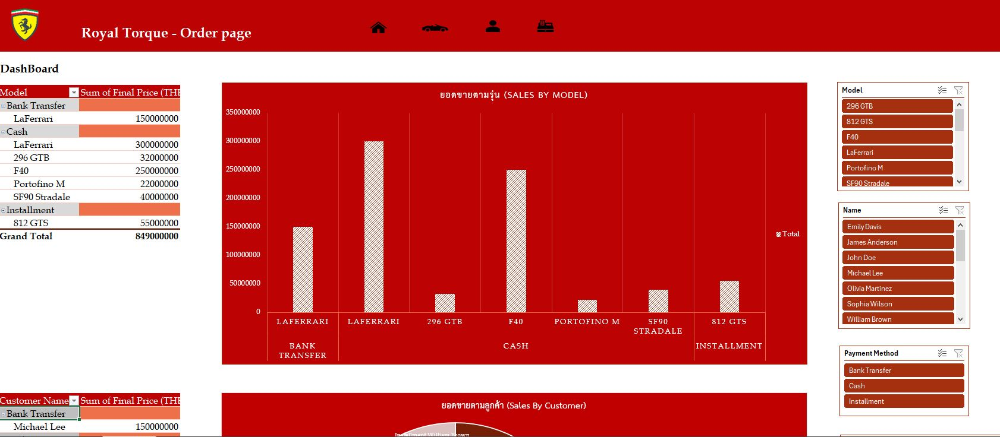
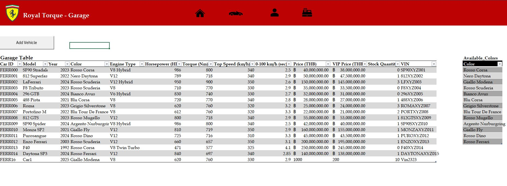
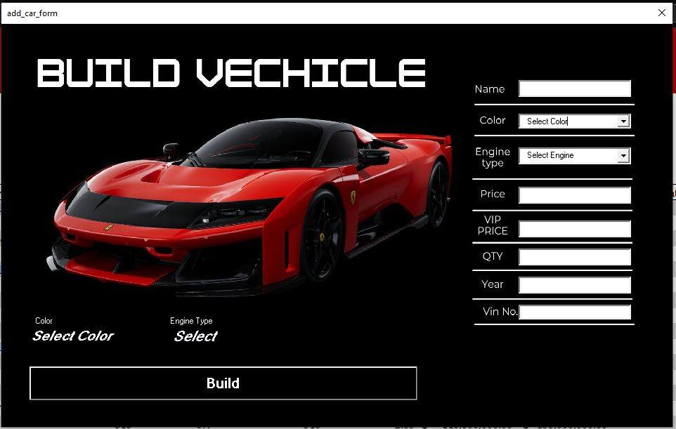
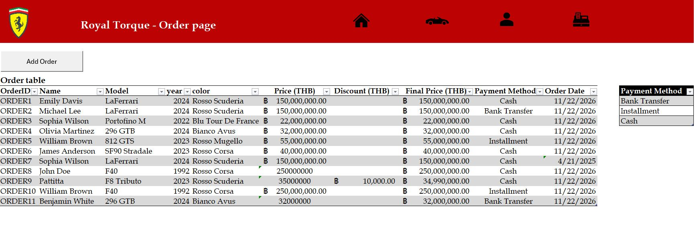
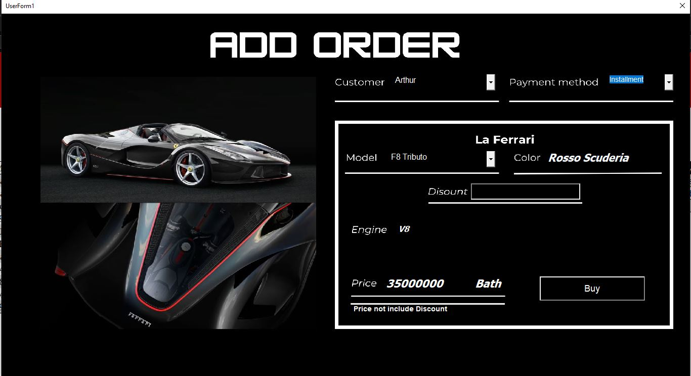
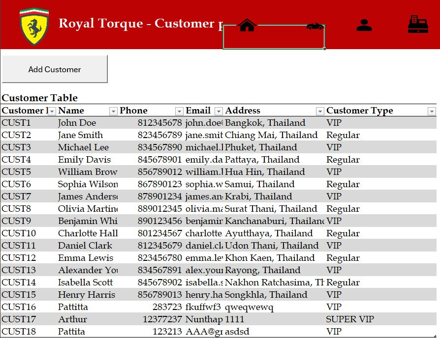
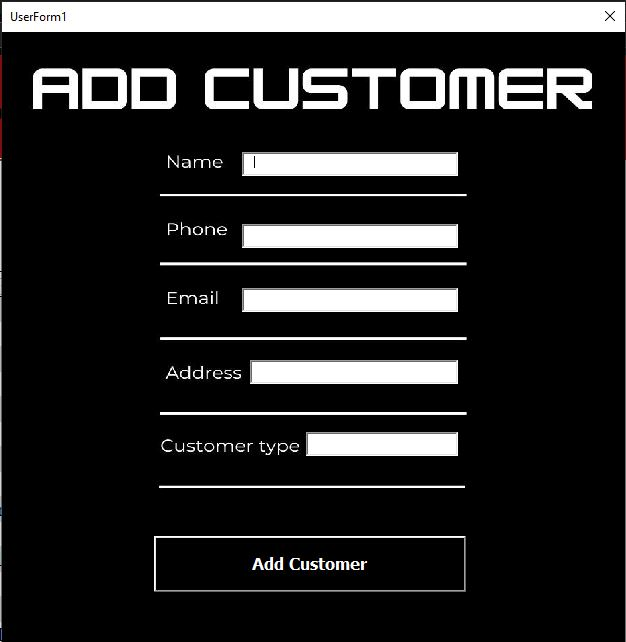

# Car Dealership Garage Management System (Excel VBA)

A car dealership garage management system built in Microsoft Excel using Visual Basic for Applications (VBA). This project showcases spreadsheet automation and structured data management across five integrated worksheets—Menu, Dashboard, Order Sheet, Garage Table, and Customer Table

## Screenshots
* **Dashboard:** demonstrates relational data consolidation and dynamic financial reporting by combining multi-level Pivot Tables

* **Garage sheet:** Structured vehicle inventory list equipped with an Add Vehicle button that opens a custom-UI VBA Build Vehicle form—allowing users to select specifications, name their customized vehicle, and automatically append the new entry into the table.

* **Order sheet:** Sales order table equipped with an Add Order button that opens a VBA order-entry form—allowing users to pair customers from the Customer sheet with existing vehicles from the Garage Table and append new sales records directly to the list

* **Customer sheet:** Customer list table, providing the personal information and customer type, equipped with Add Customer UserForm for add more customer into the table

## Project Background

This repository was developed as part of a college project for the **App-for-Dev** class (2025), showcasing practical business application development using Microsoft Excel and VBA.
